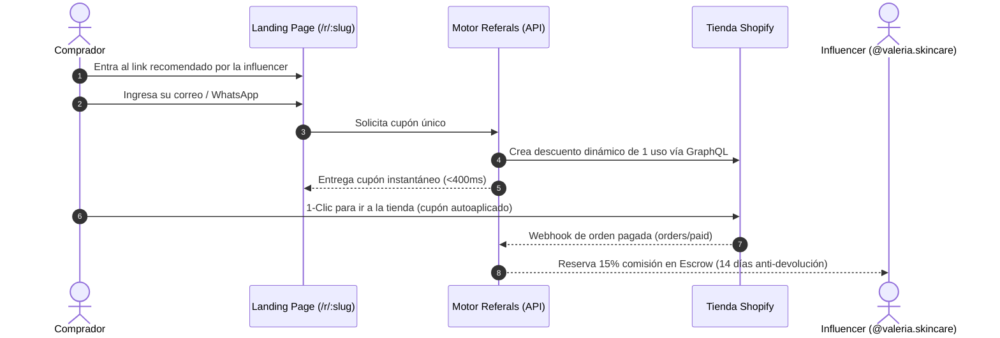

# 🧪 Guía de Validación y Pruebas de Calidad (QA) — Referals

> **Objetivo del Documento:**  
> Esta guía permite al equipo interno, directores y evaluadores realizar una **auditoría completa y prueba en vivo** de la plataforma Referals, validando la experiencia del comprador, la integración con Shopify y el motor de comisiones y escrow.

---

## 🧭 Resumen del Flujo de Negocio

---

## 📋 Protocolo de Pruebas para el Equipo (Paso a Paso)

---

### 🧪 Prueba 1: La Experiencia del Comprador (Zero-Friction UI)
**Objetivo:** Verificar que un seguidor de la influencer puede obtener su descuento en milisegundos sin registros engorrosos ni fricción.

1. **Abrir el link de campaña en cualquier navegador o celular:**  
   👉 **[https://acoustic-indianapolis-shed-struct.trycloudflare.com/r/valeria-serum-facial-iluminador-glow](https://acoustic-indianapolis-shed-struct.trycloudflare.com/r/valeria-serum-facial-iluminador-glow)**

2. **Puntos clave a validar visualmente:**
   - [ ] **Identidad del Creador:** En la parte superior debe decir claramente: *Recomendado por @valeria.skincare*.
   - [ ] **Diseño y Estética:** Paleta oficial esmeralda/pizarra (Emerald/Slate), diseño limpio y responsivo.
   - [ ] **Datos del Producto:** Debe mostrar *Serum Facial Iluminador Glow* y el precio de referencia.

3. **Interacción:**
   - Escribe cualquier correo electrónico (ej. `tu_nombre@empresa.com`).
   - *(Opcional)* Pon tu teléfono y marca la casilla de WhatsApp si deseas respaldo.
   - Haz clic en el botón verde: **`Obtener mi código`**.

4. **Criterios de Éxito esperados:**
   - [ ] El código de descuento aparece en pantalla en **menos de 400 milisegundos**.
   - [ ] El formato del código sigue el estándar seguro: `REF-VALER-[4_CARACTERES]` (ej. `REF-VALER-NZRK`).
   - [ ] Se activa un temporizador regresivo de **48 horas**.
   - [ ] El botón **`Copiar`** funciona con 1 solo clic.
   - [ ] Aparece el botón de acción: **`Ir a la tienda con mi descuento`**.

---

### 🧪 Prueba 2: Auto-Aplicación en Shopify (Conversión sin Fricción)
**Objetivo:** Validar que el comprador no tiene que memorizar ni pegar el código en la tienda; el sistema lo inyecta solo.

1. **Acción:**  
   En la pantalla del cupón, haz clic en el botón verde:  
   👉 **`Ir a la tienda con mi descuento`**.

2. **Acceso a la tienda de prueba:**  
   *(Como la tienda está en modo privado de prueba, si te solicita contraseña escribe: **`skesta`** y da Enter).*

3. **Verificación en el Carrito:**  
   - Haz clic en el producto **`Serum Facial Iluminador`** y agrégalo al carrito.
   - Abre la bolsita de compras a la derecha.

4. **Criterios de Éxito esperados:**
   - [ ] En el desglose del carrito aparece automáticamente aplicado el código `REF-VALER-...`.
   - [ ] Se refleja el descuento del **-10% ($10.00 MXN)** sobre el subtotal.
   - [ ] El total a pagar cambia a **$90.00 MXN**.

---

### 🧪 Prueba 3: Auditoría en el Panel de Administración de Shopify
**Objetivo:** Demostrarle a las marcas que Referals no genera códigos basura masivos, sino que administra cupones limpios y controlados.

1. **Acción:**  
   Entrar al panel de administrador de Shopify:  
   👉 **[https://admin.shopify.com/store/x7cpq5-z3](https://admin.shopify.com/store/x7cpq5-z3)**
2. Ir a la sección: **`Descuentos`** (*Discounts*).

3. **Criterios de Éxito esperados:**
   - [ ] Cada código solicitado por los evaluadores aparece listado individualmente con el prefijo `Referals REF-...`.
   - [ ] Estado: **Activo**.
   - [ ] Regla: **1 uso por cliente** (evita filtraciones masivas en internet).
   - [ ] Descuento: **10% en todo el pedido**.

---

### 🧪 Prueba 4: Liquidación, Comisiones y Escrow Anti-Devolución
**Objetivo:** Comprobar la seguridad financiera y el reparto de ingresos para marcas y creadores.

Cuando un comprador finaliza su pedido en Shopify, los servidores de Shopify notifican a Referals mediante Webhooks seguros con firma criptográfica `HMAC-SHA256`.

**Matemática Financiera Determinística (Ejemplo de una orden de $100 MXN):**

| Concepto | Cálculo | Monto Real | Explicación |
| :--- | :---: | :---: | :--- |
| **Precio de Lista** | — | $100.00 MXN | Precio original en el catálogo de Shopify. |
| **Descuento Comprador** | -10% | -$10.00 MXN | Beneficio exclusivo generado por el influencer. |
| **Venta Neta Cobrada** | Subtotal | **$90.00 MXN** | El dinero real que ingresa a la cuenta bancaria de la marca. |
| **Comisión del Influencer** | 15% sobre $90 | **$13.50 MXN** | Dinero reservado para Valeria. |
| **Take-Rate de Referals** | 3% sobre $90 | **$2.70 MXN** | Tarifa que cobra Referals a la marca por operar el software. |
| **Periodo de Escrow** | 14 días naturales | **En custodia** | El dinero queda bloqueado hasta el 28 de octubre. Si el cliente cancela o devuelve, no se paga nada. |
| **Pago al Creador** | Transferencia SPEI | **CLABE Banxico** | Liberado el escrow, el sistema programa el depósito a su cuenta interbancaria. |

---

## ✅ Matriz de Aprobación Final (Sign-Off del Equipo)

| Módulo Evaluado | Responsable | Estado | Notas |
| :--- | :--- | :---: | :--- |
| **Landing Page de Campaña** | QA / UX Lead | [ ] Aprobado | Velocidad <400ms, diseño y copy claros. |
| **Generación de Códigos Únicos** | Tech Lead | [ ] Aprobado | Crockford Base32, un solo uso. |
| **Inyección en Shopify** | E-commerce Manager | [ ] Aprobado | Auto-apply URL funcional en checkout. |
| **Firma de Webhooks HMAC** | Seguridad / DevOps | [ ] Aprobado | Verificación criptográfica estricta. |
| **Motor de Escrow y Ledger** | Finanzas / PM | [ ] Aprobado | 14 días de garantía y matemática en centavos. |

---

### 📞 Soporte Durante las Pruebas:
Si algún miembro del equipo tiene dudas durante la validación o requiere resetear datos de prueba, comunicarse directamente con el **Principal Product Manager**.
