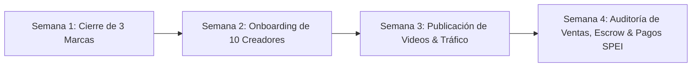

# 🚀 Kit Comercial de Prospección & Go-To-Market — Referals México

> **Misión del Piloto (Primeros 30 días):**  
> Onboarding de **3 a 5 marcas mexicanas en Shopify** + **10 a 15 microinfluencers (5k–50k en TikTok/Instagram)** para validar el loop completo de ventas, cupones de un solo uso y pagos por SPEI.

---

## 💎 Parte 1: Propuesta de Valor Diferencial (Los 3 Pilares)

Para vender Referals no necesitas prometer cosas abstractas; resuelves los 3 mayores dolores del e-commerce y de los creadores en México:

| Dolor de la Marca en México | Solución Única de Referals |
| :--- | :--- |
| **Cupones filtrados:** Crean un código genérico (`MARIA10`) y termina en foros, extensiones como Honey o grupos de Facebook, perdiendo margen en clientes que ya iban a comprar. | **Cupones de un solo uso instantáneos:** Cada comprador recibe un código único (`REF-LUP-4K9M`) que solo sirve 1 vez y se autoaplica al carrito. |
| **Comisiones pagadas por ventas devueltas:** El influencer cobra pero el cliente cancela o devuelve el producto a los 7 días. | **Escrow inteligente (14–28 días):** La comisión queda en custodia y solo se libera si la compra se mantiene firme. Cero riesgo de pérdidas. |
| **Cero costo fijo:** Las marcas no quieren otra mensualidad de SaaS de $50 o $100 USD si no tienen ventas garantizadas. | **100% a éxito:** Solo pagan la comisión acordada cuando la venta ya está cobrada en su cuenta bancaria. |

---

## 📱 Parte 2: Prospección para Marcas de E-commerce (Shopify)

### Perfil Ideal de Marca (Target Inicial):
- **Nichos:** Skincare, cosmética, moda/ropa, suplementos o snacks saludables, accesorios/joyería.
- **Plataforma:** Tienda activa en Shopify México.
- **Tamaño:** Marcas con 5,000 a 50,000 seguidores en Instagram que ya hagan envíos a todo México.
- **Contacto:** Fundador(a), Director(a) de Marketing o E-commerce Manager.

---

### Plantilla A: WhatsApp Directo al Fundador / E-commerce Manager
*(El canal más efectivo en México. Envíalo si consigues su número personal o el WhatsApp de soporte de la marca pidiendo hablar con el encargado de marketing).*

> **Asunto / Mensaje:**  
> "Hola **[Nombre]**, ¿cómo estás? Te escribo rápido porque sigo a **[Nombre de la Marca]** y me encanta lo que hacen con **[mencionar un producto estrella o su último lanzamiento]**.  
>   
> Soy **[Tu Nombre]**, fundador de **Referals**. Estamos lanzando un piloto exclusivo con 5 marcas mexicanas en Shopify para activar ventas con microinfluencers en TikTok e Instagram, pero **sin pagar suscripciones ni costos fijos**.  
>   
> Funciona 100% a comisión sobre ventas cobradas y tiene dos cosas que no tiene ningún otro software:  
> 1. **Cupones de un solo uso:** Se generan al instante para cada cliente, así evitamos que tu código termine filtrado en Honey o cuponeras.  
> 2. **Garantía anti-devoluciones:** Si un cliente cancela o devuelve el pedido, no pagas ninguna comisión (el dinero se libera tras un periodo de garantía de 14 a 21 días).  
>   
> Se conecta a tu Shopify en 3 minutos. ¿Te parecería que te muestre una demo de 5 minutos esta semana para ver si hace sentido para **[Nombre de la Marca]**?"

---

### Plantilla B: Mensaje para LinkedIn / Correo Electrónico
*(Ideal para marcas un poco más medianas o corporativas donde contactas al Gerente de E-commerce).*

> **Asunto:** Nueva forma de monetizar microinfluencers para **[Nombre de la Marca]** (100% a éxito)  
>   
> Hola **[Nombre]**, gusto en saludarte.  
>   
> Veo que en **[Nombre de la Marca]** tienen una presencia muy sólida en digital. Sé que el marketing de influencers tradicional suele ser un dolor de cabeza: pagos por adelantado a creadores que no garantizan ventas, o códigos de descuento que terminan filtrándose en internet y canibalizando tu margen.  
>   
> Desarrollamos **Referals**, la primera plataforma en México de marketing de afiliados basada en **cupones dinámicos de un solo uso**:  
> - **Cero costo fijo:** Solo pagas la comisión acordada cuando la venta neta se refleja en tu Shopify.  
> - **Protección contra fraudes:** Los códigos son únicos por comprador y expiran al usarse.  
> - **Escrow automático:** Cero comisiones pagadas si el cliente solicita reembolso.  
> - **Conexión en 3 clics** con tu tienda de Shopify mediante Webhooks seguros.  
>   
> Estamos seleccionando 5 marcas líderes para nuestro programa piloto con condiciones preferenciales de lanzamiento.  
>   
> ¿Tendrías 10 minutos este **[Día, ej: Jueves]** para una llamada rápida y mostrarte cómo activar tu primer campaña?  
>   
> Saludos cordiales,  
> **[Tu Nombre]**  
> Fundador & CEO | Referals México  
> `http://201.79.62.170:3000` *(o tu dominio si ya está activo)*

---

## 🎨 Parte 3: Reclutamiento de Microinfluencers (TikTok / Reels)

### Perfil Ideal de Creador:
- **Seguidores:** 5,000 a 40,000 en TikTok o Instagram Reels.
- **Engagement:** Creadores orgánicos con alta interacción en comentarios (preguntan "¿dónde lo compraste?", "¿tienes descuento?").
- **Dolor:** Tienen audiencia pero las marcas grandes no les pagan colaboraciones fijas.

---

### Plantilla C: DM de Instagram / TikTok para Creadores
*(Tono fresco, directo, enfocado en que ellos moneticen de inmediato sin trámites complicados).*

> "Hola **[Nombre del Creador]**! 👋 Me encanta el contenido que subes sobre **[tema: ej. skincare / outfits / tips]**, la vibra de tu comunidad es increíble.  
>   
> Te escribo porque tenemos una alianza con marcas mexicanas como **[Nombre de Marca aliada]** que quieren colaborar contigo mediante **Referals**.  
>   
> Lo padre:  
> ✅ Te damos un link personalizado donde tus seguidores consiguen un descuento exclusivo que se aplica solo con 1 clic.  
> ✅ Te generamos un guion probado con Inteligencia Artificial con el gancho ideal para tu estilo de video.  
> ✅ Ganas entre **[ej: 10% y 15%]** de comisión en dinero real por cada compra que se haga con tu link.  
> ✅ Recibes tu dinero directo por **transferencia SPEI a tu cuenta bancaria (CLABE)** sin enredos ni mínimos imposibles.  
>   
> ¿Te gustaría que te mande tu link y el producto para que empieces a cobrar este mismo mes? Dime y te paso el link por aquí o WhatsApp!"

---

### Plantilla D: Mensaje de Onboarding por WhatsApp (Cuando dicen "Sí")
*(Inmediatamente después de registrarlos en el sistema).*

> "¡Bienvenido/a a Referals, **[Nombre]**! 🎉  
>   
> Ya quedó lista tu campaña para **[Nombre de la Marca]**. Aquí tienes todo en charola de plata:  
>   
> 🔗 **Tu Link Exclusivo para Bio / Stories:**  
> `http://201.79.62.170:3000/r/[TU_SLUG]` *(Ej: `.../r/glow-maria`)*  
> *(Cuando tu seguidor entra, le da un descuento único y lo manda directo a la tienda con el cupón puesto)*  
>   
> 🎬 **Tu Guion Sugerido para TikTok / Reels:**  
> **Gancho (Primeros 3 seg):** *"[Insertar el gancho generado por la IA en Referals]"*  
> **Desarrollo (10 seg):** *"[El beneficio clave del producto]"*  
> **Llamado a la Acción:** *"Vayan al link de mi perfil para agarrar su cupón único antes de que se agoten."*  
>   
> 💰 **Tus Comisiones:**  
> Ganas **[X]%** por venta. En cuanto la orden se entregue, tu saldo pasa a liberado y te lo transferimos a tu CLABE **[Últimos 4 dígitos]**.  
>   
> ¡Sube tu video y nos etiquetas para darle amor desde el día 1! 🚀"

---

## 📊 Parte 4: Metodología del Piloto de 30 Días

### 1. Semana 1: Cierre de Marcas
- Contactar a 20 marcas en Instagram/WhatsApp usando la **Plantilla A**.
- Meta: Cerrar 3 marcas que acepten ofrecer entre **10% y 15% de descuento** al cliente y **10% a 15% de comisión** al creador.
- Conectar su Shopify a Referals mediante la API/Webhooks.

### 2. Semana 2: Reclutamiento de Creadores
- Identificar creadores que usen o encajen con los productos de las 3 marcas.
- Enviar 30 mensajes con la **Plantilla C**.
- Meta: 10 a 15 creadores activos con sus links generados en la base de datos de Referals.

### 3. Semana 3: Tráfico y Conversión
- Los creadores publican su video con el link en su bio de TikTok o sticker en Instagram Stories.
- Los compradores acceden a `/r/:slug`, copian su código instantáneo y compran.
- Referals recibe los webhooks de compra y calcula las comisiones con matemática exacta de centavos.

### 4. Semana 4: Liquidación y Casos de Éxito
- Cumplido el periodo de escrow (14 a 21 días), el Escrow Worker (`EscrowMaturityService`) libera el saldo.
- Se ejecuta la transferencia SPEI a los creadores.
- **Resultado:** Tomas captura de pantalla de los creadores cobrando y de las marcas vendiendo. ¡Ese es el testimonio definitivo para escalar a cientos de marcas!
