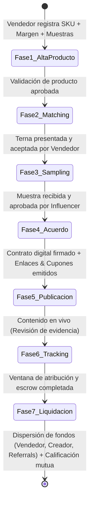

# PRD: Referrals — Plataforma Conectora de Productos e Influencers (v2.0)

> **Estado:** En Revisión (Alineado con Identidad Visual TikTok + Instagram Sólida)  
> **Autor:** Product Manager AI Wingman (Gemini)  
> **Revisor Principal & Product Owner:** Principal Product Manager (User)  
> **Fecha:** Octubre 2026  

---

## 1. Visión y Resumen Ejecutivo

**Referrals** es el conector estratégico, operativo y tecnológico que vincula a **marcas/vendedores de productos físicos y comerciales** (cosméticos, autopartes, juguetes, gadgets, hogar, etc.) con **influencers de nicho**, asegurando que cada producto se posicione frente a la audiencia correcta con esquemas de venta claros, trazabilidad total y liquidación transparente.

### Declaración de Posicionamiento
> *"El puente inteligente que une productos con los creadores que saben venderlos."*

---

## 2. Matriz de Valor Bimodal (Two-Sided Marketplace)

| Eje | Para la Marca / Vendedor | Para el Creador / Influencer |
| :--- | :--- | :--- |
| **Problema Resuelto** | Elimina pagos a ciegas y menciones vacías a audiencias desconectadas. | Elimina ofertas de productos dudosos y la falta de pagos formales. |
| **Garantía Operativa** | Muestras rastreadas, acuerdos estandarizados y entregables verificados. | Muestras gratuitas previas para testeo y contratos con fechas y reglas claras. |
| **Modelo Financiero** | Pago de comisiones únicamente sobre ventas reales y netas cobradas. | Monetización híbrida garantizada: Pago base por contenido + % de comisiones por venta. |

---

## 3. Flujo Operativo de 7 Fases (Lifecycle de Campaña)



### Detalle Operativo por Fase

#### Fase 1: Alta y Validación del Producto (Entrada del Vendedor)
* **Datos comerciales:** Categoría, Precio de Venta al Público (PVP en $ MXN), margen bruto disponible y unidades de stock reservadas.
* **Propuesta de valor y público meta:** Rango de edad, intereses, problemas que resuelve el producto y enlaces directos al catálogo/tienda.
* **Condiciones comerciales ofertadas:** Comisión ofertada por venta (10%–30%) y disponibilidad de unidades para muestras físicas de cortesía.
* **Auditoría de Referrals:** Verificación de normatividad, viabilidad logística de entrega y suficiencia de margen para split de comisiones.

#### Fase 2: Mapeo y Scouting de Creadores Afines (Curaduría y Match)
* **Cruce algorítmico y cualitativo:** Cruce entre la categoría del producto y datos demográficos reales de la audiencia del creador (país, edad, intereses, engagement auténtico).
* **Armado de la terna:** Selección de 2 a 3 creadores idóneos con estimación de alcance y ángulo sugerido de contenido.
* **Aprobación de la marca:** El vendedor valida y aprueba a los creadores propuestos.

#### Fase 3: Contacto, Propuesta y Envío de Muestra (Sampling y Logística)
* **Pitch profesional:** Envío de propuesta formal al creador con el ángulo de venta y el esquema de ganancias (fijo base + % comisión).
* **Despacho de muestra:** El vendedor envía la muestra física e ingresa la guía de paquetería rastreable en Referrals.
* **Prueba de calidad:** El influencer recibe el paquete y valida el producto físicamente antes de comprometer su credibilidad ante su comunidad.

#### Fase 4: Firma de Acuerdo y Emisión de Atribución (Formalización)
* **Acuerdo digital:** Definición del entregable (Reel, TikTok, Stories, YouTube), fecha límite de publicación y mensajes clave obligatorios.
* **Emisión de credenciales de venta:**
  * Enlace rastreable único con parámetros UTM (`?ref=creator_slug&utm_source=referrals`).
  * Cupón de descuento exclusivo de un solo uso o prefijado por creador (ej. `REF-[SLUG]-[ENTROPY]`).

#### Fase 5: Publicación y Activación Comercial (Difusión)
* **Lanzamiento:** El influencer publica la reseña orientada a la solución del problema e instruye a su comunidad a usar su cupón o link en bio.
* **Evidencia en plataforma:** El creador sube el enlace directo de la publicación para activar formalmente la ventana de atribución.

#### Fase 6: Tracking de Ventas en Tiempo Real (Monitoreo)
* **Captura de conversiones:** Webhooks en tiempo real conectados al e-commerce del vendedor (Shopify, WooCommerce, Amazon, Mercado Libre o API directa).
* **Dashboard compartido transparente:** Tanto el vendedor como el influencer auditan clics, pedidos confirmados, comisiones acumuladas y estado del periodo de garantía.

#### Fase 7: Cierre de Campaña, Conciliación y Liquidación (Pagos y Escrow)
* **Ventana de garantía / Escrow:** Retención de 14 a 28 días según la categoría para absorber posibles devoluciones o cancelaciones de clientes.
* **Dispersión atómica de fondos:**
  * **Vendedor:** Retiene el importe neto de producto e inventario.
  * **Creador:** Recibe su pago base (si aplicó) + comisión acumulada por ventas confirmadas directamente vía transferencia bancaria (SPEI).
  * **Referrals:** Deduce su tarifa de intermediación sobre el volumen transaccionado.
* **Calificación mutua (Reputación):** Ambas partes califican la experiencia para el historial del marketplace.

---

## 4. Requerimientos Funcionales por Módulo (Epics)

### Epic 1: Catálogo de Productos y Gestión de Muestras
* **REQ-1.1:** Formulario de alta con validación de margen comercial mínimo (ej. margen >= 25% para asegurar viabilidad).
* **REQ-1.2:** Módulo logístico de muestras con campos para paquetería (DHL, Fedex, Estafeta, 99Minutos), código de rastreo y estados (`despachado`, `en_transito`, `entregado`, `rechazado`).

### Epic 2: Directorio y Perfil de Creadores de Nicho
* **REQ-2.1:** Perfil de creador con vinculación de canales sociales, nichos principales (belleza, motor, juguetes, cocina, salud), demografía de audiencia y tarifa base opcional.
* **REQ-2.2:** Indicador de confiabilidad basado en campañas completadas y tiempo promedio de publicación.

### Epic 3: Motor de Matching y Negociación
* **REQ-3.1:** Algoritmo de scoring de afinidad: Cruce de categoría de producto, ticket promedio y audiencia del creador.
* **REQ-3.2:** Sistema de propuestas con aceptación/rechazo en 1 clic y opción de contrapropuesta de términos.

### Epic 4: Generador de Credenciales y Contrato Digital
* **REQ-4.1:** Generación automática de URLs UTM determinísticas y cupones de descuento sincronizados con la plataforma del vendedor.
* **REQ-4.2:** Contrato digital con términos de uso estandarizados aceptados con firma electrónica simple / timestamp verificado.

### Epic 5: Ingestión de Webhooks y Atribución en Tiempo Real
* **REQ-5.1:** Endpoint multi-tenant para órdenes pagadas (`/v1/webhooks/orders/paid`) con verificación HMAC-SHA256 e idempotencia por `seller_order_id`.
* **REQ-5.2:** Panel en vivo con métricas de clics, órdenes, tasa de conversión y balance en escrow.

### Epic 6: Liquidación Financiera y Escrow Ledger
* **REQ-6.1:** Libro mayor inmutable (double-entry ledger) que congela las comisiones durante la ventana de devolución por categoría.
* **REQ-6.2:** Módulo de dispersión bancaria con generación de layouts de pago o integración SPEI directa.

---

## 5. Historias de Usuario Principales (INVEST) y Criterios de Aceptación

### Historia US-01: Registro de Producto y Solicitud de Muestras
* **Como** vendedor de una marca de productos físicos,  
* **quiero** dar de alta mi producto especificando márgenes, público objetivo y stock de muestras,  
* **para que** Referrals pueda emparejarme con influencers afines que puedan probar y vender mi artículo.

#### Criterios de Aceptación:
1. El sistema valida que el precio de venta (PVP) y el margen bruto permitan cubrir la comisión ofertada sin incurrir en pérdidas.
2. El vendedor puede cargar fotografías de alta resolución, dimensiones y enlace a su tienda actual.
3. Se genera un estado inicial del producto: `pendiente_auditoria` hasta que el equipo o motor de reglas valide normatividad y stock.

---

### Historia US-02: Envío y Recepción de Muestra Física (Sampling)
* **Como** creador de contenido seleccionado para una campaña,  
* **quiero** recibir una muestra física del producto con guía rastreable,  
* **para que** pueda comprobar su calidad real antes de comprometer mi reputación ante mi comunidad.

#### Criterios de Aceptación:
1. Cuando la marca despacha el producto, la guía de envío y paquetería se reflejan en el panel del creador.
2. Al recibir la muestra, el creador tiene un plazo máximo de 5 días hábiles para marcar `muestra_aprobada` o `muestra_rechazada` con justificación.
3. Si el creador aprueba la muestra, se desbloquea automáticamente la Fase 4 (Acuerdo y Emisión de Atribución).

---

### Historia US-03: Atribución y Liquidación Escrow Post-Garantía
* **Como** creador y vendedor en una campaña activa,  
* **quiero** ver las ventas atribuidas en tiempo real y que los fondos se liberen al terminar la ventana de garantía,  
* **para que** el vendedor no pague por ventas devueltas y el creador tenga certeza de cobro directo a su cuenta.

#### Escenario Gherkin:
```gherkin
Scenario: Liquidación exitosa tras ventana de devolución cumplida
  Given una campaña activa con comisión del 20% sobre producto de $1,000 MXN
  And una orden de compra pagada registrada el día 1 con cupón atribuido al creador
  And una ventana de escrow de 21 días para categoría General Retail
  When transcurren 21 días naturales sin que el cliente haya solicitado reembolso
  Then el motor de escrow marca el balance como disponible para liquidación
  And se genera el registro contable en el ledger para dispersión al creador por $200 MXN
  And se emite el comprobante digital para ambas partes
```

---

## 6. Arquitectura Visual & Sistema de Diseño (TikTok + Instagram Sólido)
* **Estética:** Alta energía, contraste dinámico y pulcritud editorial inspirada en TikTok e Instagram, pero **estrictamente con colores sólidos y sin degradados**.
* **Tokens de Color Oficiales:**
  * Fondo: Blanco Puro (`#FFFFFF`) y Pizarra Neutra (`#F8FAFC`).
  * Texto y Títulos: Pizarra Profunda (`#0F141C`) de alto contraste (WCAG AAA).
  * Energía & Tendencias (TikTok Coral Sólido): `#FE2C55`.
  * Editorial & Redes (Instagram Berry Sólido): `#D62976`.
  * Datos & Match (Cyan Eléctrico Sólido): `#00B4D8`.
  * Dinero, Éxito & Escrow (Fresh Mint Sólido): `#10B981` / `#059669`.
  * Avisos & Garantía (Ámbar Sólido): `#F59E0B`.
* **Cifras Financieras:** `font-variant-numeric: tabular-nums; font-feature-settings: "tnum";` para precios ($ MXN), comisiones (%), cupones y temporizadores.
* **Accesibilidad Universal:** Botones táctiles mínimos de 48px de alto, textos grandes y legibles para todo rango de edad (jóvenes, adultos y personas de la tercera edad).
